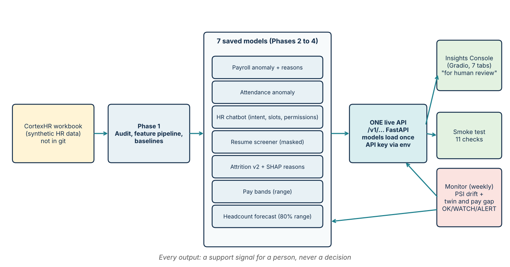
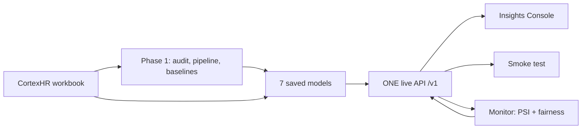

# Architecture of the whole project

How one employee travels from raw data to a reason in the console: the raw HR row (Phase 1 cleans it and removes leakage columns) -> attrition-v2 scores it (calibrated probability) -> SHAP finds the top drivers -> a lookup turns them into plain sentences -> the row is stored in the serving table -> `GET /v1/attrition/risk/EMP-0004` returns it -> the Risks tab shows the band and 3 reasons with the label "AI-generated, for human review" -> the weekly monitor checks that the inputs have not drifted.
